# AstraNL

[](https://registry.modelcontextprotocol.io/v0/servers?search=com.astranl/mcp&version=latest) [](https://github.com/ASTRANL/astranl-mcp/stargazers) [](#30-second-quickstart)



**No-key MCP server that gives AI agents source-linked Dutch real-world facts and coordination:** planning cost figures for construction jobs (not quotes), permit fees and municipal build rules, KvK, VAT and sanctions checks on a counterparty, live building-material checks, catalog offers, coordination of physical tasks with KvK-registered executors, certificates that record the fact of an agreement and machine-checkable evidence from a signed public log. Reading, asking and verifying need no key and cost nothing. Fee: 1% coordination fee - only on a paid outcome, in force since 2026-09-01. `order_materials`, `estimate_case_create` and `estimate_case_video` reuse a free agent key from `POST https://astranl.com/api/agents/register`.

## 30-second quickstart

Server URL (Streamable HTTP, no API key): `https://astranl.com/mcp/streamable`

**Claude.ai / Claude Desktop:** Settings, Connectors, Add custom connector, then paste the server URL.

**Claude Code**

```bash
claude mcp add --transport http astranl https://astranl.com/mcp/streamable
```

**Cursor** (`~/.cursor/mcp.json`)

```json
{
  "mcpServers": {
    "astranl": { "url": "https://astranl.com/mcp/streamable" }
  }
}
```

**VS Code** (`.vscode/mcp.json`)

```json
{
  "servers": {
    "astranl": { "type": "http", "url": "https://astranl.com/mcp/streamable" }
  }
}
```

**ChatGPT** (developer mode): create a connector with the server URL and no authentication.

**OpenAI Responses API and Agents SDK** (remote MCP tool with `server_url`): runnable script in [examples/openai_responses_mcp.py](examples/openai_responses_mcp.py).

**Clients that only speak stdio**

```json
{
  "mcpServers": {
    "astranl": { "command": "npx", "args": ["-y", "mcp-remote", "https://astranl.com/mcp/streamable"] }
  }
}
```

More runnable examples: [examples/](examples/)

## Try it

Ask your agent:

> Use AstraNL: what is the 2026 permit fee (leges) in Zaanstad for a renovation with EUR 50,000 building cost, and do I need a permit to put a skip on the street?

Your client should call `nl_municipal_build_rules`, a read-only tool. It returns the fee with the regulation, article and source URL it is taken from, and the rule for a skip on the public road.

## What AstraNL is

AstraNL MCP Server — Give AstraNL one real thing you need changed. It coordinates the rest. AstraNL is the neutral coordination and evidence layer between intent and real-world execution. It connects existing systems, agents and organisations to the right real-world capability - human, company, machine, robot, stock, transport or service - and returns a typed record of what was actually observed, agreed, executed and settled.

AstraNL turns an intent into verified real-world execution: a KvK-registered executor performs the work; the client pays that provider directly on the agreed provider-owned business rail. Stripe is optional. AstraNL never receives or controls the work amount and invoices only its separate 1% coordination fee after a paid, confirmed outcome.

Fee: 1% coordination fee - only on a paid outcome, in force since 2026-09-01.

Money: broker; custody never - AstraNL does not receive or hold the principal amount. Each order explicitly binds its payment rail and named provider. Optional Stripe uses the existing executor destination-charge model. Direct business-bank payment is independently initiated by the principal to the provider's verified business account; Stripe rail only: existing hold-release terms apply. Ordinary bank transfers have no AstraNL hold, automatic release or automatic refund.

Geography: ordering open to a principal anywhere; execution Netherlands, where KvK-registered executors stand (registry ID checked; each executor's verification state is shown on its card at /truth/executors.json - never a bare "verified"). A country is listed the day a registry-checked, payout-ready executor stands in it, never before.

Public capabilities: `ask_astranl`, `check_counterparty_nl`, `check_estimate_materials`, `check_material`, `check_task`, `commitment_attest`, `commitment_confirm`, `commitment_verify`, `construction_economy`, `construction_events`, `construction_laws`, `construction_leadtimes`, `construction_natura`, `construction_permits`, `construction_summary`, `construction_tenders`, `construction_zones`, `coordination_contract`, `create_task`, `estimate_case_answer`, `estimate_case_create`, `estimate_case_files`, `estimate_case_status`, `estimate_case_video`, `estimate_cost`, `fetch`, `find_offers`, `get_evidence`, `ground_astranl`, `ground_citation`, `ground_component`, `housing_need`, `machines_search`, `market_indicators`, `network_door`, `nl_municipal_build_rules`, `order_materials`, `read_with_receipt`, `record_counterparty_check`, `search`, `verify_astranl`.

Canonical source of truth for every channel: https://astranl.com/.well-known/astranl-facts.json (canon block, generated 2026-11-21T01:54:02.655739+00:00).

## Live metrics (auto-refreshed daily 02:00 UTC; last refresh 2026-11-21)

- **MCP server version:** 1.37.47
- **API version:** v4.0
- **OpenAPI paths exposed:** 198
- **MCP tools advertised:** 41
- **Dispatchable task classes:** 29
- **Official [MCP Registry](https://registry.modelcontextprotocol.io/v0/servers?search=com.astranl&version=latest):** `com.astranl/mcp` v1.37.47 is the latest active entry; 5 `com.astranl` servers are active in total
- **Glama:** not listed yet for this repository

## More ways to connect

### Endpoints

```
Server (streamable HTTP): https://astranl.com/mcp/streamable
Legacy SSE fallback: https://astranl.com/mcp/sse
Server card: https://astranl.com/.well-known/mcp/server-card.json
```

### Dutch counterparty check (read-only, no key, no account)

Connect `https://astranl.com/mcp/streamable?profile=counterparty`; this address lists three tools:
`check_counterparty_nl`, `record_counterparty_check` and `verify_astranl`. Example request to your agent:
"Before paying, check supplier KvK 24330087, name Coolblue B.V., VAT NL810433941B01."

- Sources: KVK Handelsregister search, EU VIES, EU consolidated sanctions list. Solvency is not connected and stays UNKNOWN.
- Each result states what it proves, what it does not prove and the next permitted action, and carries a `result_sha256`
  that anyone can recompute: `python3 astranl_verify.py --result result.json` (https://astranl.com/spec/astranl_verify.py).
- A register or VAT confirmation says a registration or number exists; it does not confirm an invoice or its content.
- ChatGPT, Codex and other MCP clients: https://astranl.com/check-counterparty/

## Pricing manifest

Live at https://astranl.com/capabilities/dispatch/manifest

## Provider

- **Organisation:** AstraNL
- **Jurisdiction:** Netherlands (KvK 88449335, BTW NL004604224B69)
- **Controls (scoped, self-assessed, not certified):** EU AI Act Art. 50 disclosure in every interaction; GDPR: controller for coordination metadata only (https://astranl.com/privacy.html); money: AstraNL never holds third-party funds (https://astranl.com/.well-known/payment-truth.json)
- **Fee:** 1% coordination fee - only on a paid outcome, in force since 2026-09-01
- **Liability:** AstraNL coordinates; the contract is between principal and executor; AstraNL's own liability is capped at the coordination fee charged on the errand. Canonical, always-current: https://astranl.com/.well-known/astranl-facts.json (canon epoch 2026-11-21T01:54:02.655739+00:00)

## Discovery

- A2A agent card: https://astranl.com/.well-known/agent-card.json
- Public OpenAPI 3.1.0 contract (positive allowlist): https://astranl.com/openapi.json (198 paths); small importable errand spec: https://astranl.com/agent-hands/openapi.json
- Public operation registry: https://astranl.com/.well-known/public-operations.json
- Public docs: https://astranl.com/docs
- Federation node: https://astranl.com/.well-known/astranl-node.json
- Contributing, bug reports and tool requests: [CONTRIBUTING.md](CONTRIBUTING.md); security reports: [SECURITY.md](SECURITY.md)

_This README is regenerated daily by `github_repo_auto_refresher.py` from live metrics. No marketing claims, only measured numbers._
